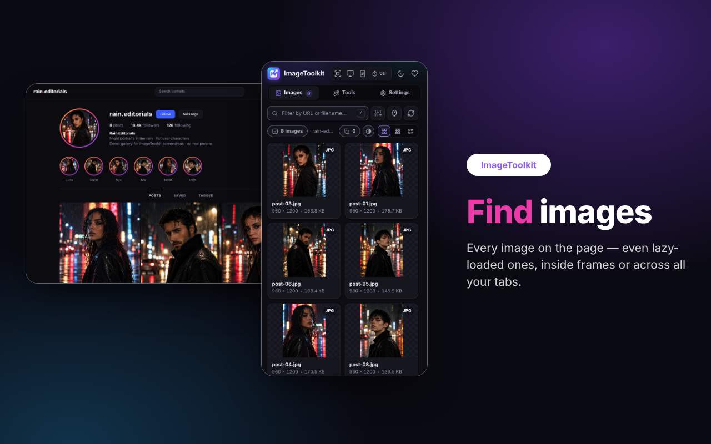
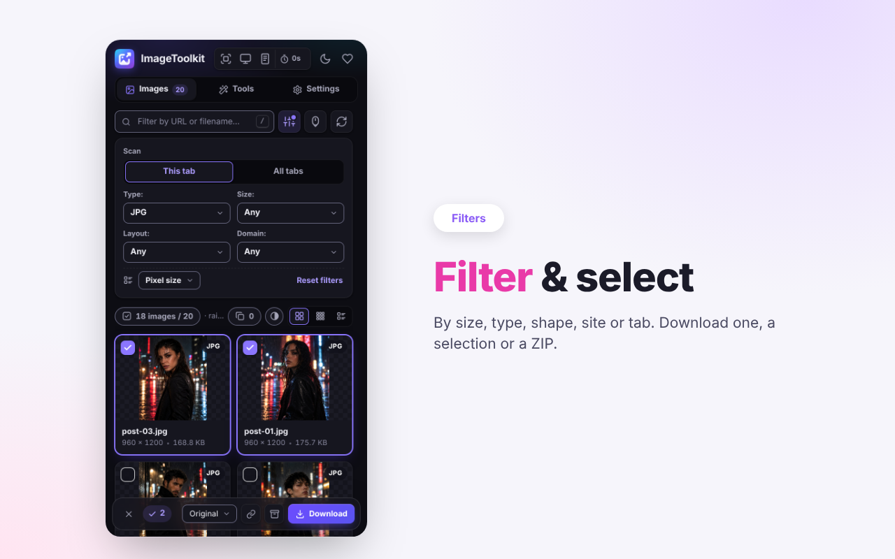
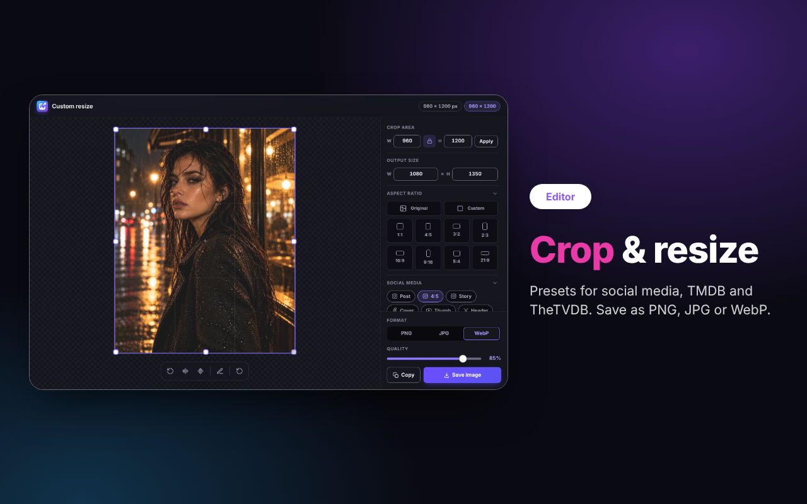
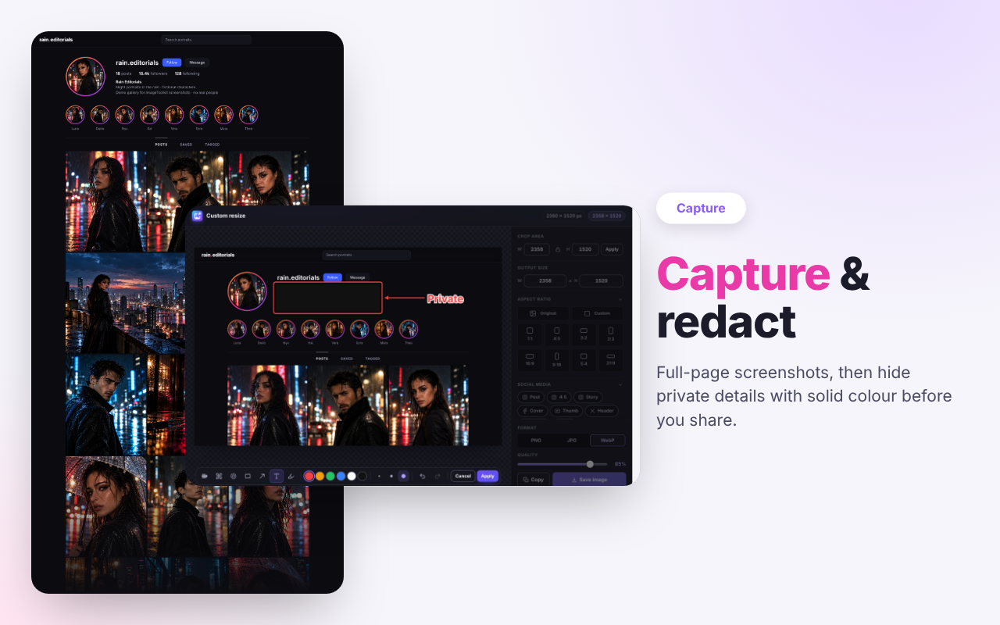
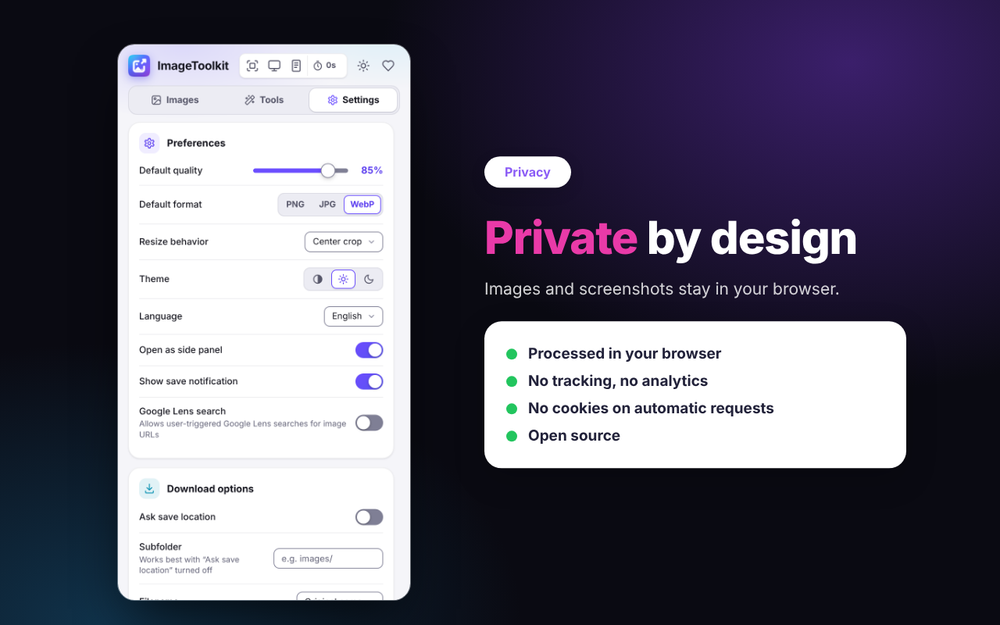

<h1 align="center">
  <picture>
    <source media="(prefers-color-scheme: dark)" srcset="docs/brand/lockup-dark.svg">
    
  </picture>
</h1>

> **The browser extension to find, save, convert, capture, crop and optimize images — 100% local, zero tracking.**

[](LICENSE)
[](https://developer.chrome.com/docs/extensions/mv3/)
[](https://github.com/BlackSpirits/ImageToolkit/actions/workflows/ci.yml)

---

## 🎨 Brand

The mark is a single continuous image frame that opens into an export arrow: find an image, work on it, take it with you. It sits on a cyan → indigo → violet tile, the same gradient the interface uses in its light, dark and automatic themes.

- Vector sources and usage rules live in [`docs/brand`](docs/brand): three cuts of the mark (Master for 64 px and up, Compact for 32/48 px, Micro for 16 px) and the light/dark wordmark.
- `npm run build:icons` renders every PNG in `icons/` from those sources, including the 128 px store icon with the 16 px padding the Chrome Web Store asks for.

## 📸 Screenshots

<p align="center">
  
</p>
<p align="center">
  
  
</p>
<p align="center">
  
  
</p>

The characters in the demo gallery are fictional. `npm run store:shots` renders these images from the real extension in all 18 languages, plus the store's promo tiles — see [`docs/store`](docs/store/README.md).

## ✨ Features

### 🔄 Format Conversion
Right-click any image and save it as **PNG**, **JPG** or **WebP**. Transparent images get a white background when converting to JPG — no more black artifacts. AVIF images are listed, downloaded as they are and converted to any of those formats; **AVIF as an output** appears by itself on browsers that can write it (Chrome cannot yet), so a format offered always produces exactly that format.

### 📥 True "Original" Downloads
**Original** keeps the exact source bytes — GIF animation, SVG vectors and JPEG quality are preserved, and the file extension comes from the real content type, even when the URL has none.

### 🖼️ Image Grid
Browse every image on the current page — **iframes included** — or on **every tab of the window at once**, in a fast grid, compact grid or list, with dimensions, file size and type. Search by URL, file name or alt text, and filter by **format**, **size range**, **shape**, **domain** or **tab**. Hotlink-protected thumbnails are fetched through the extension so they still show, and transparent images can be checked on a checkerboard or on a white, grey or black background. Inline SVG icons are listed at the size the page shows them, with the page's colours. In the side panel, the grid follows the active tab and page loads automatically.

While the panel is open, new images are announced as they appear: ``, `<picture>` sources, inline SVG and inline-style backgrounds. Images added only through stylesheet classes show up on the next refresh. `blob:` URLs are not listed.

**Load all images** scrolls the page (or the scrolling area of app-like pages) to the end, wakes lazy images, waits for infinite scroll and collects images at every step — so feeds that unload what leaves the screen lose nothing — then puts you back where you were. It has a progress bar and can be stopped.

### ⌨️ Keyboard & Selection
- Shift-click selects a range, Ctrl/⌘-click toggles a single image
- Arrow keys move between images, **Enter** opens the preview, **Space** selects
- **/** focuses the search, **Ctrl/⌘ + A** selects everything visible, **Esc** clears
- In the preview, ← / → browse through the filtered images

### 📸 Screen Capture
Capture an **area**, the **visible page** (both with an optional 3/5/10-second delay) or the **full page**. The result opens in a **new tab next to the page**, whole and at the page's own width: scroll through it or fit all of it in the window (a click on the image switches), then **Save** as PNG, JPG or WebP, **Copy**, or go on to **Crop** or **Annotate** in the same tab and come back with **Back to screenshot**. Full-page captures are stitched locally: fixed headers and chat buttons appear once instead of on every slice, the scrollbar is left out, very tall pages are scaled before being cut, progress shows on the toolbar icon and **Esc** cancels. Start it from the panel, by right-clicking the toolbar icon, or with the `Alt+Shift+S` shortcut (customizable in `chrome://extensions/shortcuts`).

### ✂️ Editor
The editor opens in a tab next to the page it came from. Crop, rotate and flip with presets for aspect ratios, common resolutions, social networks (Instagram, Facebook, YouTube, X, LinkedIn, Pinterest), TMDB and TheTVDB. Pick the output size and format, then **Save** (`Ctrl/⌘ + S`) or **Copy** (`Ctrl/⌘ + C`) the result.

**Annotate** to redact or mark up before saving: **redact** with opaque colour (the sure way to hide data), **pixelate** (true block averages) and **blur** as softer effects, draw **boxes**, **arrows**, **text** (outlined so it reads on any background) and **highlights**, in six colours and three thicknesses, with undo/redo and one-key shortcuts (X P B R A T H). Marks scale with the image, and nothing changes until you press Apply (Ctrl+Enter).

### 📋 Copy & Paste
Copy any image to the clipboard as PNG, ready to paste into Slack, Discord, Figma or any app, or copy its link. Paste an image (or an image URL) anywhere in the panel with **Ctrl/⌘ + V** to open it in Tools, or drag one in from a web page.

### 🧠 Format Advisor
Load an image in Tools and see how large it would be as PNG, JPG and WebP next to the original — with a recommendation that respects transparency.

### 🔁 Duplicate Detection
Duplicate detection flags the same image address listed more than once, ignoring only the host's case, the order of parameters and tracking tags (`utm_*`, `fbclid`…), so different pictures are never merged. Duplicates can be hidden with one click. It is URL-based, not pixel-based.

### 📦 Batch Download
Select images and download them one by one (never one Save As dialog per image) or as a single ZIP, in their original format or converted. ZIP entries follow your file name settings and never collide. Copy all selected URLs in one click.

### ⚙️ Settings
- Default quality and format, resize behavior (center crop or fit/letterbox)
- Save As dialog, notifications, side panel or popup
- Subfolder, file name pattern (original, system, custom prefix or a **template** with `{name}` `{site}` `{domain}` `{title}` `{index}` `{width}` `{height}` `{format}` `{date}` `{time}` and `/` for folders, with a live preview), convert-on-download, ZIP by default
- Editor presets: show or hide each group (aspect ratios, social media, common sizes, TMDB, TheTVDB) and add up to 24 sizes of your own
- Optional, off-by-default Google Lens search
- Auto / light / dark theme (auto follows the system; the panel button switches between light and dark) and 18 interface languages

### 🌍 Multilingual
18 languages, all fully translated (see [TRANSLATION_AUDIT.md](TRANSLATION_AUDIT.md)), with right-to-left layout for Arabic. The interface language can be overridden in Settings.

---

## 🔒 Privacy

- **Nothing goes to the author** — no servers, no account; images and screenshots are processed locally in your browser
- **No analytics, no tracking, no remote scripts** — everything is bundled
- **No cookies on automatic requests** — thumbnails and size checks go only to the image addresses found in the page, without your cookies
- **`host_permissions: <all_urls>`** — needed to scan pages and to fetch cross-origin images for conversion. Optional actions such as Google Lens only run when enabled and clicked.

See [PRIVACY.md](PRIVACY.md) for the full privacy policy.

---

## 🚀 Installation

### From Chrome Web Store
*(Coming soon)*

### Manual (Developer Mode)
1. Download or clone this repository
2. Open `chrome://extensions/`
3. Enable **Developer mode**
4. Click **Load unpacked**
5. Select the project folder

---

## 🏗️ Architecture

```
ImageToolkit/
├── manifest.json          MV3 manifest
├── background.js          Service worker: menus, commands, routing, downloads, capture, probing
├── offscreen.html/js      Canvas engine: conversion, resize, crop (+ clipboard fallback)
├── content.js             Image scanner (injected on demand)
├── capture.js             Area-selection overlay (injected on demand)
├── popup.html/css/js      Panel UI: Images, Tools, Settings (popup and side panel)
├── resize.html/css/js     Editor tab (Cropper.js)
├── view.html/css/js       Capture viewer tab: save, copy, crop, annotate
├── lib/
│   ├── core.js            Pure helpers shared by every context (and unit-tested)
│   ├── i18n.js            chrome.i18n-compatible language override
│   ├── ui.js / ui.css     Design tokens and shared UI components
│   ├── handoff.js         IndexedDB handoff of images between contexts
│   ├── annotate.js        Editor annotations: redact, pixelate, blur, boxes, arrows, text
│   └── jszip / cropper    Bundled third-party libraries (MIT)
├── _locales/              18 language packs
├── tests/                 Unit (node:test) and end-to-end (Playwright) tests
└── scripts/               Validation and Web Store bundle build
```

### Design Decisions

- **Offscreen document** for canvas work — no code is injected into pages to convert images
- **On-demand scripts** — the scanner and the capture overlay are only injected when you use them, and the live observer stops after a few idle minutes
- **Least trust between contexts** — the service worker only accepts privileged messages from extension pages; content scripts can report captures and new images, nothing else
- **Real formats** — output names follow the format actually produced, and "Original" keeps the source bytes
- **Clipboard where there is focus** — the panel and editor write to the clipboard directly; context-menu copies are written from the page you right-clicked
- **Bounded work** — image size, canvas area, the scan's message size, probe requests and bytes, preview downloads and ZIP size are all capped, per item and in total
- **No frameworks** — plain JS/CSS, system fonts, one SVG icon sprite

---

## 🧪 Development

```bash
npm run validate   # manifest, file references, JS syntax, i18n parity/placeholders/usage
npm run check:contrast # WCAG AA for every text/background token pair, both themes
npm test           # unit tests (node:test, no dependencies)
npm run build      # dist/imagetoolkit-<version>.zip with runtime files only
npm run build:icons # re-render icons/*.png from docs/brand (needs Playwright Chromium)
npm run store:shots # Web Store slides in docs/store/<locale> from the demo page (needs Playwright Chromium)

npm ci && npx playwright install chromium
npm run test:e2e   # loads the extension in Chromium and drives real flows
```

CI runs all of the above on every pull request.

---

## 🤝 Contributing

Contributions are welcome! Please feel free to submit a Pull Request.

1. Fork the repository
2. Create your feature branch (`git checkout -b feature/amazing-feature`)
3. Run `npm run check` (and `npm run test:e2e` for UI changes)
4. Commit your changes and open a Pull Request

---

## 📄 License

This project is licensed under the **MIT License** — see [LICENSE](LICENSE) for details.

---

## 💖 Support

If you find this extension useful, consider supporting development:

[](https://ko-fi.com/blackspirits)

---

<p align="center">
  Made with ❤️ by <a href="https://blackspirits.github.io">BlackSpirits</a>
</p>
